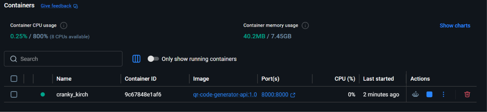
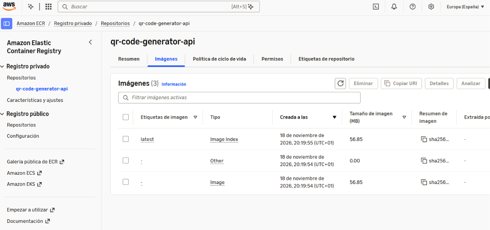

# QR Code Generator API

A lightweight, stateless REST API built with **Python**, **FastAPI**, and **Docker** that generates customizable QR codes from text or URLs.

The project demonstrates API development, containerization, automated testing, and cloud deployment practices using AWS.

> **Project Status:** Docker implementation completed and tested locally. Container image successfully published to Amazon ECR. AWS ECS Fargate deployment in progress.

## Tech Stack

- **Python 3.12** – Backend development
- **FastAPI** – REST API framework
- **Uvicorn** – ASGI server
- **QRCode & Pillow** – QR code generation
- **Docker** – Application containerization
- **Pytest** – Automated testing
- **AWS ECR** – Container image registry (completed)
- **AWS ECS & Fargate** – Cloud container deployment (in progress)

## Features

- Generate QR codes from text or URLs.
- Customize QR code size and border.
- Download generated QR codes as PNG images.
- Input validation using FastAPI.
- Automatic API documentation with Swagger UI.
- Health check endpoint.
- Stateless architecture without database dependencies.
- Containerized execution using Docker.

## API Endpoints

| Method | Endpoint | Description |
|--------|----------|-------------|
| GET | `/health` | Check API health status |
| GET | `/qr?text=hello` | Generate a QR code in PNG format |
| GET | `/docs` | Interactive Swagger UI documentation |

### QR Code Parameters

| Parameter | Type | Default | Description |
|-----------|------|---------|-------------|
| `text` | string | Required | Text or URL to encode (1–1000 characters) |
| `box_size` | integer | 10 | Size of each QR code module (2–20) |
| `border` | integer | 4 | Border width in modules (1–10) |

### Example Request

```http
GET /qr?text=https://www.google.com&box_size=10&border=4
```

The API returns a PNG image containing the generated QR code.

All QR codes are generated in memory. No user data is stored.

## Local Development

### Prerequisites

- Python 3.12+
- Git

### 1. Clone the Repository

```bash
git clone https://github.com/hassxa/qr-code-generator-api.git

cd qr-code-generator-api
```

### 2. Create a Virtual Environment

Windows PowerShell:

```powershell
py -m venv .venv

.\.venv\Scripts\Activate.ps1
```

### 3. Install Dependencies

```powershell
pip install -r requirements-dev.txt
```

### 4. Start the Application

```powershell
uvicorn app.main:app --reload
```

The application will be available at:

http://localhost:8000/docs

## Docker Deployment

The application is containerized using Docker, allowing consistent execution across different environments.

### 1. Build the Docker Image

```bash
docker build -t qr-code-generator-api:1.0 .
```

This command builds a Docker image using the instructions defined in the Dockerfile.

### 2. Verify the Image

```bash
docker images
```

### 3. Run the Container

```bash
docker run --rm -p 8000:8000 qr-code-generator-api:1.0
```

This command creates and starts a container from the previously built image.

The application runs on port 8000.

### 4. Verify the Deployment

**Health Check**

http://localhost:8000/health

Expected response:

```json
{
  "status": "ok"
}
```

**Swagger Documentation**

http://localhost:8000/docs

**QR Code Generation**

http://localhost:8000/qr?text=HelloWorld

### Docker Implementation Details

The Docker configuration includes:

- Python 3.12 slim base image.
- Optimized dependency installation using Docker layer caching.
- Non-root user execution for improved security.
- Environment variables for Python runtime behavior.
- Container health checks.
- Port 8000 exposure and port mapping.
- `.dockerignore` to exclude unnecessary files.
- Stateless container architecture.

## Docker Demonstration

The application has been successfully built and executed locally using Docker Desktop.

### Docker Image

The Docker image was successfully created using the project's Dockerfile.


### Running Container

The container executes the FastAPI application and exposes port 8000.



### API Demonstration

The application generates QR codes through its REST API.

The following screenshot shows a successful HTTP 200 response and the generated PNG image using Swagger UI.


## Automated Testing

The project includes automated tests using **Pytest** and FastAPI's TestClient.

The tests cover:

- Health check endpoint.
- Successful PNG generation.
- Empty text validation.
- Missing required parameters.
- Maximum text length validation.
- Invalid QR code size validation.

Run the tests using:

```bash
pytest -q
```

## AWS Deployment

The application is being deployed on Amazon Web Services (AWS) using container-based infrastructure.

**AWS Region:** Europe (Spain) – `eu-south-2`

### Amazon ECR – Container Registry

The Docker image has been successfully pushed to Amazon Elastic Container Registry (ECR).

Amazon ECR provides a private registry for storing and managing container images.

**Repository Configuration:**

- **Repository Name:** `qr-code-generator-api`
- **Repository Type:** Private
- **AWS Region:** `eu-south-2`
- **Image Tag:** `latest`

#### Docker Image Publication

The deployment process includes:

1. Building the Docker image locally.
2. Authenticating Docker with Amazon ECR.
3. Tagging the image for the ECR repository.
4. Pushing the image to AWS.
5. Verifying the image in the Amazon ECR console.

#### Amazon ECR Evidence

The following screenshot confirms that the Docker image has been successfully uploaded to Amazon ECR.



### Amazon ECS & AWS Fargate

**Status:** In progress.

The next phase involves deploying the containerized FastAPI application using Amazon ECS with AWS Fargate.

The planned deployment will include:

- An Amazon ECS cluster.
- A Fargate task definition.
- Container configuration.
- Network and security group configuration.
- Application health checks.
- Amazon CloudWatch logging.
- Public API accessibility for testing.

Deployment instructions and screenshots will be added after completing this phase.

## Future Improvements

- Complete AWS ECS deployment with Fargate.
- Implement Infrastructure as Code using Terraform.
- Deploy the application locally using Kubernetes.
- Configure a CI/CD pipeline with GitHub Actions.
- Implement automated Docker image builds and deployment workflows.

## License

This project is licensed under the MIT License.