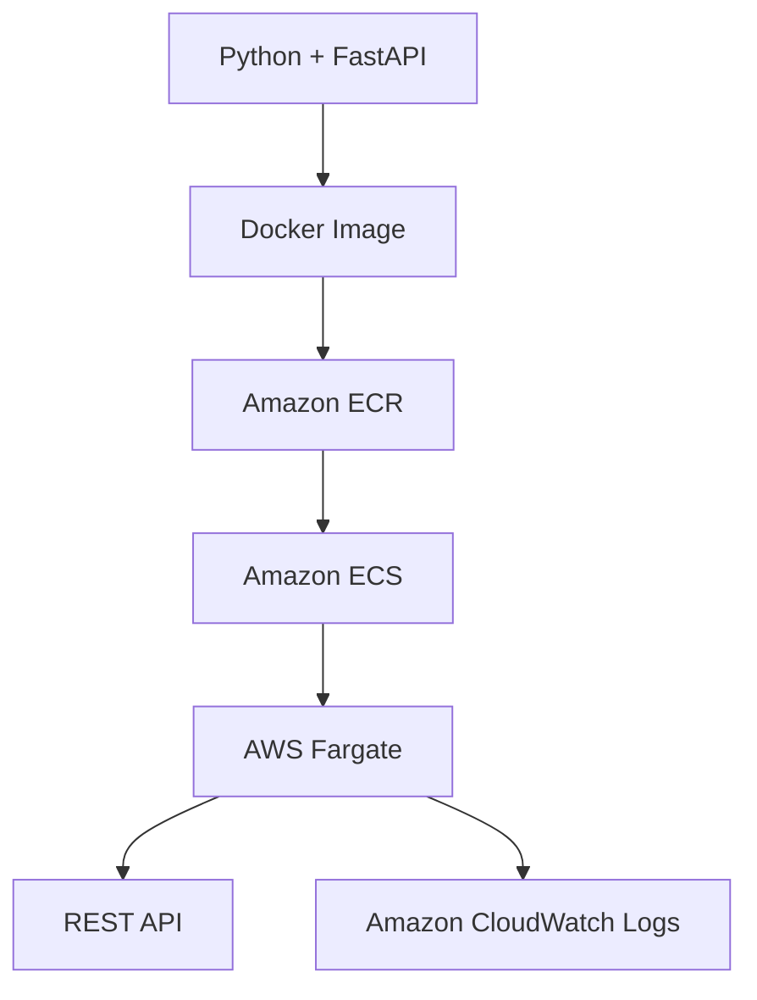
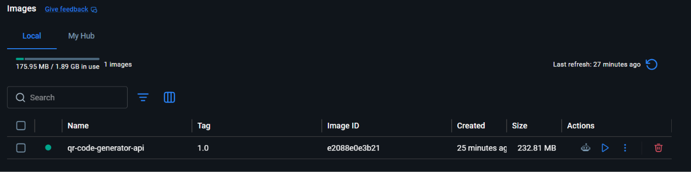
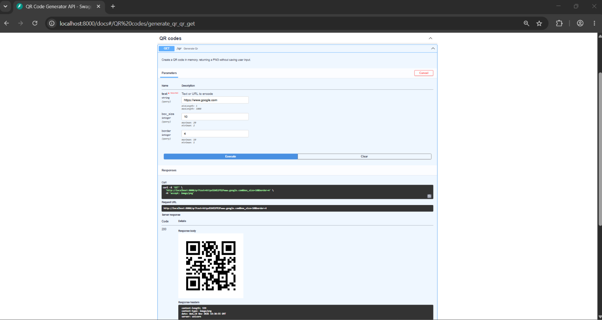
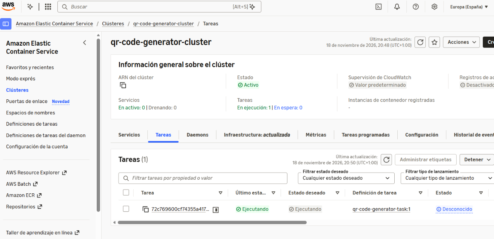
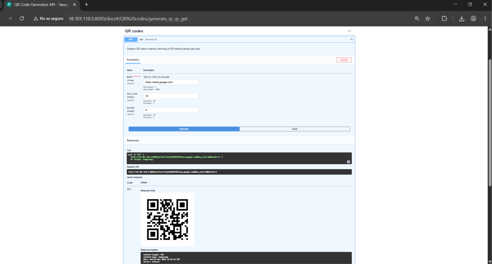
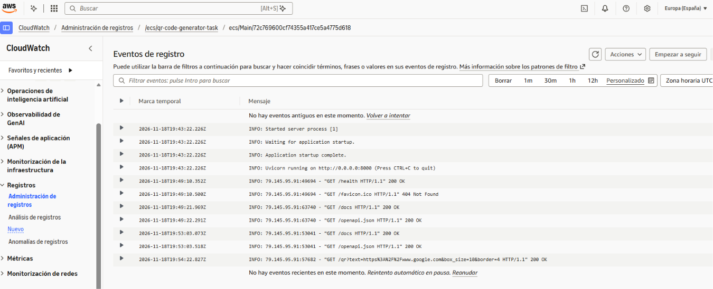

# QR Code Generator API

A lightweight, stateless REST API built with **Python**, **FastAPI**, and **Docker** that generates customizable QR codes from text or URLs.

This project demonstrates REST API development, Docker containerization, automated testing, and container deployment on Amazon Web Services (AWS).

> **Project Status:** Successfully developed, containerized, and deployed on AWS ECS Fargate. The deployment was verified and subsequently stopped to minimize cloud costs.

## Tech Stack

| Technology | Purpose |
|------------|---------|
| Python 3.12 | Backend development |
| FastAPI | REST API framework |
| Uvicorn | ASGI web server |
| QRCode & Pillow | QR code generation |
| Docker | Application containerization |
| Pytest | Automated testing |
| Amazon ECR | Container image registry |
| Amazon ECS | Container orchestration |
| AWS Fargate | Serverless container execution |
| Amazon CloudWatch | Application logging and monitoring |

## Features

- Generate QR codes from text or URLs.
- Customize QR code size and border.
- Download generated QR codes as PNG images.
- Input validation using FastAPI.
- Automatic API documentation with Swagger UI.
- Health check endpoint.
- Stateless architecture without database dependencies.
- Containerized execution using Docker.
- Deployment on AWS ECS using Fargate.
- Centralized application logging with Amazon CloudWatch.

## API Endpoints

| Method | Endpoint | Description |
|--------|----------|-------------|
| GET | `/health` | Check API health status |
| GET | `/qr?text=hello` | Generate a QR code in PNG format |
| GET | `/docs` | Interactive Swagger UI documentation |

### QR Code Parameters

| Parameter | Type | Default | Description |
|-----------|------|---------|-------------|
| `text` | string | Required | Text or URL to encode (1–1000 characters) |
| `box_size` | integer | 10 | Size of each QR code module (2–20) |
| `border` | integer | 4 | Border width in modules (1–10) |

### Example Request

```http
GET /qr?text=https://www.google.com&box_size=10&border=4
```

The API returns a PNG image containing the generated QR code.

All QR codes are generated in memory. No user data is stored.

## Architecture

The application follows a container-based architecture deployed on AWS.



### Architecture Components

**FastAPI**

Provides REST endpoints for generating QR codes and checking application health.

**Docker**

Packages the application and its dependencies into a portable container image.

**Amazon ECR**

Stores the Docker image in a private AWS container registry.

**Amazon ECS**

Manages the container deployment using a task definition and cluster.

**AWS Fargate**

Provides the compute resources required to execute the container without managing EC2 instances.

**Amazon CloudWatch**

Collects application logs, including server startup events and HTTP requests.

## Local Development

### Prerequisites

- Python 3.12+
- Git

### 1. Clone the Repository

```bash
git clone https://github.com/hassxa/qr-code-generator-api.git

cd qr-code-generator-api
```

### 2. Create a Virtual Environment

Windows PowerShell:

```powershell
py -m venv .venv

.\.venv\Scripts\Activate.ps1
```

### 3. Install Dependencies

```powershell
pip install -r requirements-dev.txt
```

### 4. Start the Application

```powershell
uvicorn app.main:app --reload
```

Access the interactive documentation:

http://localhost:8000/docs

## Docker Deployment

The application is containerized using Docker, allowing consistent execution across development and cloud environments.

### 1. Build the Docker Image

```bash
docker build -t qr-code-generator-api:1.0 .
```

### 2. Verify the Image

```bash
docker images
```

### 3. Run the Container

```bash
docker run --rm -p 8000:8000 qr-code-generator-api:1.0
```

The application runs inside the container on port 8000.

### 4. Verify the Deployment

**Health Check**

http://localhost:8000/health

Expected response:

```json
{
  "status": "ok"
}
```

**Swagger Documentation**

http://localhost:8000/docs

**QR Code Generation**

http://localhost:8000/qr?text=HelloWorld

### Docker Implementation Details

The Docker configuration includes:

- Python 3.12 slim base image.
- Optimized dependency installation using Docker layer caching.
- Non-root user execution for improved security.
- Environment variables for Python runtime behavior.
- Container health checks.
- Port 8000 exposure and port mapping.
- `.dockerignore` to exclude unnecessary files.
- Stateless container architecture.

## Docker Demonstration

The application was successfully built and executed locally using Docker Desktop.

### Docker Image

The Docker image was created using the project's Dockerfile.



### Running Container

The container executes the FastAPI application and exposes port 8000.


### API Demonstration

The application generates QR codes through its REST API.

The following screenshot shows a successful HTTP 200 response and the generated PNG image using Swagger UI.



## Automated Testing

The project includes automated tests using **Pytest** and FastAPI's TestClient.

The tests cover:

- Health check endpoint.
- Successful PNG generation.
- Empty text validation.
- Missing required parameters.
- Maximum text length validation.
- Invalid QR code size validation.

Run the tests using:

```bash
pytest -q
```

## AWS Deployment

The application was successfully deployed on Amazon Web Services using Amazon ECS and AWS Fargate.

**AWS Region:** Europe (Spain) – `eu-south-2`

### 1. Amazon ECR – Container Registry

The Docker image was pushed to Amazon Elastic Container Registry.

**Repository Configuration:**

- **Repository Name:** `qr-code-generator-api`
- **Repository Type:** Private
- **AWS Region:** `eu-south-2`
- **Image Tag:** `latest`

The image publication workflow included:

1. Building the Docker image locally.
2. Authenticating Docker with Amazon ECR.
3. Tagging the image for the ECR repository.
4. Pushing the image to AWS.
5. Verifying the image in Amazon ECR.

#### Amazon ECR Evidence


### 2. Amazon ECS – Container Orchestration

An Amazon ECS cluster was created to manage the application deployment.

**Cluster Configuration:**

- **Cluster Name:** `qr-code-generator-cluster`
- **Launch Type:** AWS Fargate
- **Operating System:** Linux
- **Architecture:** X86_64

**Task Definition:**

- **Task Family:** `qr-code-generator-task`
- **Container Name:** `qr-code-api`
- **Container Image:** Amazon ECR
- **CPU:** 0.25 vCPU
- **Memory:** 0.5 GB
- **Container Port:** 8000
- **Network Mode:** awsvpc

A standalone ECS task was launched using AWS Fargate.

The task successfully pulled the container image from Amazon ECR and started the FastAPI application.

#### ECS Deployment Evidence

The following screenshot confirms that the ECS task reached the RUNNING state.



### 3. Public API Verification

The application was temporarily exposed through a public IPv4 address assigned to the Fargate task.

Network connectivity was configured using:

- Amazon VPC
- Public subnet
- Public IPv4 address
- Security Group
- TCP port 8000

The deployed application was successfully accessed through its public endpoint.

The API documentation and QR code generation functionality were verified.

**Validation Results:**

- FastAPI application started successfully.
- Swagger UI was accessible.
- QR code generation returned HTTP 200.
- PNG images were generated correctly.

#### AWS API Demonstration



### 4. Amazon CloudWatch – Application Logging

Application logs were collected using Amazon CloudWatch Logs.

CloudWatch provided visibility into:

- Uvicorn server startup.
- FastAPI application initialization.
- Incoming HTTP requests.
- HTTP response status codes.
- Application activity during deployment.

The following endpoints were successfully recorded:

```text
GET /health    200 OK
GET /docs      200 OK
GET /qr        200 OK
```

#### CloudWatch Logs Evidence



### 5. Resource Cleanup and Cost Management

The application was deployed temporarily for testing and portfolio demonstration.

After validating the deployment:

- The standalone ECS task was stopped.
- Fargate compute consumption was terminated.
- Public access was disabled after testing.
- The Amazon ECR repository and ECS configuration were retained for future use.

**Note:** The public API endpoint is not permanently available. The application can be redeployed using the existing container image and ECS task definition.

## Key Technical Skills Demonstrated

This project demonstrates practical experience with:

- Python REST API development.
- FastAPI and OpenAPI documentation.
- Docker image creation and container execution.
- Dockerfile optimization and container security.
- AWS CLI authentication and configuration.
- Amazon ECR image management.
- Amazon ECS cluster and task configuration.
- AWS Fargate container deployment.
- IAM task execution roles.
- VPC networking and Security Groups.
- Amazon CloudWatch application logging.
- Cloud resource lifecycle and cost management.

## Future Improvements

- Implement Infrastructure as Code using Terraform.
- Deploy the application locally using Kubernetes.
- Configure a CI/CD pipeline using GitHub Actions.
- Automate Docker image builds and deployment workflows.
- Implement HTTPS using an Application Load Balancer and AWS Certificate Manager.
- Add automated deployment validation.

## License

This project is licensed under the MIT License.